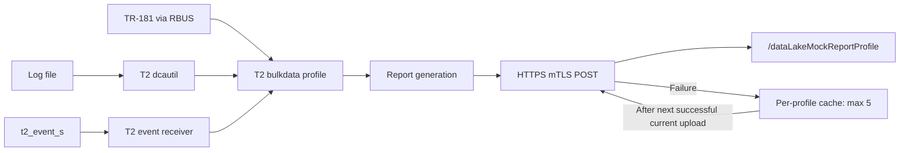

# T2 Docker spike write-up

## Scope and quick checks

This is a source-and-evidence review, not a new runtime test. Use [SETUP.md](SETUP.md) for commands, [EVIDENCE.md](EVIDENCE.md) for chronology, and [SAMPLES.md](SAMPLES.md) for receipt annotations. Source citations below are relative to `telemetry/` unless otherwise stated; checkout is `a2f2a545e4bd6170eac96f7c0c46fbd4df6f1654`. The original installed commit remains unknown.

Step 16's separately executed fresh-run verification is recorded in
[EVIDENCE.md](EVIDENCE.md#step-16-final-verification). Its new all-marker receipt is
annotated in [SAMPLES.md](SAMPLES.md#step-16-fresh-run-receipt); historical sample
counts below are not current-run acceptance results.

At Step 12, `grep -c SPIKE_MATCH utils/t2-spike.log` returned **21**, matching that step's `"SPIKE_GREP":"21"`. Changed-hash reload replaces the profile (`source/bulkdata/reportprofiles.c:1020-1045`); `freeProfile` frees its seek state (`source/bulkdata/profile.c:249-251`). Marker configuration creates fresh state (`source/t2parser/t2parser.c:1068`); `createGrepSeekProfile` creates an empty map (`source/dcautil/legacyutils.c:75-82`). `getLogSeekValue` then executes `*seek_value = 0` for a missing entry (`source/dcautil/dca.c:421-438`). This explains rescanning old matches, not 21 new triggers. Identical hashes are ignored. Separately, `getGrepResults` clears state after collection when `isClearSeekMap` is true (`source/dcautil/dcautil.c:204-210`).

Upload headers are source-confirmed, not wire-captured: `init_connection_pool` appends `"Accept: application/json"` and `"Content-type: application/json"` (`source/protocol/http/multicurlinterface.c:447,456`). `http_pool_post` sets `CURLOPT_POST, 1L` and `CURLOPT_HTTPHEADER, post_headers` (`:989-990`). No custom header is added in this upload path. The collector logs `console.log('Data received: ' + data)`, not `req.headers` or `req.method` (`docker-device-mgt-service-test/mock-xconf/data-lake-mock.js:102-114`); its response Content-Type is not evidence of request headers.

## Six spike answers

### Q1. Startup and runtime paths

The native entrypoint starts RBUS/providers, not T2 (`docker-device-mgt-service-test/native-platform/entrypoint.sh:44-57`).
Check with `docker exec native-platform pgrep -a telemetry2_0`; preserve the running daemon, and use SETUP only for separately authorized startup.
Runtime executable is `/usr/local/bin/telemetry2_0`; log is `/opt/logs/telemetry2_0.txt.0`.
Profiles, cache, XConf and seek state live under `/opt/.t2reportprofiles/`, `/opt/.t2cachedmessages/`, `/opt/.t2persistentfolder/`, `/opt/.t2seekmap/` (`source/utils/persistence.h:31-48`); temporary profiles use `/tmp/t2reportprofiles/`.

### Q2. Marker choices

Use grep for existing log text: the fixture counts `SPIKE_MATCH` in `/mnt/L2_CONTAINER_SHARED_VOLUME/utils/t2-spike.log`.
Use events for direct component instrumentation: `t2_spike` sends absolute `SPIKE_EVENT` through `t2_event_s`.
Use dataModel for provider-backed TR-181 state: `SPIKE_DM` reads `Device.X_RDK_WebConfig.webcfgSubdocForceReset`.
`CollectAndReport` calls `getGrepResults`, `encodeGrepResultInJSON`, and `encodeEventMarkersInJSON` (`source/bulkdata/profile.c:576-582`); RBUS dispatch is in `source/ccspinterface/busInterface.c:71-118`.

### Q3. Profile structure and loading

[The fixture](utils/t2-spike-profile.json) wraps `name`, `hash`, and `value` in `profiles`; value supplies HTTP/JSON, 30-second interval, Parameter, HTTP destination, and JSONEncoding.
JSON works through `rbuscli setvalues Device.X_RDKCENTRAL-COM_T2.ReportProfiles string '<JSON>'`; recommend this for the demo.
MsgPack worked historically as a base64 **string** at `Device.X_RDKCENTRAL-COM_T2.ReportProfilesMsgPack`; the setter uses `g_base64_decode` (`source/ccspinterface/rbusInterface.c:572-602`).
XConf at `https://mockxconf:50050/loguploader/getT2DCMSettings` is blocked by missing providers; it requires legacy `urn:settings:TelemetryProfile` (`source/t2parser/t2parserxconf.c:220-248`), not that envelope.

### Q4. Report contract

The tested NameValuePair body is `{"Report":[{"SPIKE_DM":"false"},{"SPIKE_GREP":"21"},{"SPIKE_EVENT":"spike-event-ok"}]}`.
All values in these samples are strings; neither timestamp nor device IDs are present. This is the tested profile contract, not a claim about all possible profiles.
`initJSONReportProfile` creates the root array (`source/bulkdata/profile.c:282-290`); `encodeParamResultInJSON` uses `cJSON_AddStringToObject` (`source/reportgen/reportgen.c:518`).
ReportTimestamp parses into `tsFormat` (`source/t2parser/t2parser.c:1464-1480`), but no emission consumer was found; Step 12 confirms no timestamp despite Unix-Epoch. Per-marker timestamps are distinct.

### Q5. Upload and recovery

Reports POST to `https://mockxconf:50051/dataLakeMockReportProfile` with the JSON headers above and mTLS; `http_pool_post` sets P12 credentials and peer verification (`source/protocol/http/multicurlinterface.c:1130-1133`).
Curl 6/7 failures lead to per-profile cache; `MAX_CACHED_REPORTS` is 5 (`source/bulkdata/reportprofiles.h:37`).
`CollectAndReport` tags and persists failures (`source/bulkdata/profile.c:818-842`); `tagReportAsCached` adds `"REPORT_TYPE":"CACHED"` (`source/reportgen/reportgen.c:1813-1826`).
After the next successful current upload, cached reports replay (`profile.c:901-916`); scheduled retry is the next reporting interval, 30 seconds here, not exponential backoff. Certificate-selector retries are separate.

### Q6. Minimum event-marker code

Include `telemetry_busmessage_sender.h` and link `-ltelemetry_msgsender`; send only after profile activation.
Compile inside native-platform with `gcc -I/usr/local/include /mnt/L2_CONTAINER_SHARED_VOLUME/utils/t2-spike-event.c -L/usr/local/lib -Wl,-rpath,/usr/local/lib -ltelemetry_msgsender -o /tmp/t2-spike-event`.
The API declares `t2_init`, `t2_event_s`, and `t2_uninit` (`include/telemetry_busmessage_sender.h:42,51,77`).
The actual [utils/t2-spike-event.c](utils/t2-spike-event.c) is reproduced verbatim:

```c
#include <stdio.h>
#include <telemetry_busmessage_sender.h>

int main(void)
{
    t2_init("t2_spike");
    T2ERROR result = t2_event_s("SPIKE_EVENT", "spike-event-ok");
    printf("t2_event_s returned %d\n", (int)result);
    t2_uninit();
    return result == T2ERROR_SUCCESS ? 0 : 1;
}
```

## Flow



## Recommendations

Custom component markers should use events first: they are direct and have no log dependency; send only after the profile is active. Use grep for existing logs, watching for reload rescans. Use DM only once a real provider exists.

The dashboard should parse `{"Report":[{name:value}]}`, flatten single-key objects, and treat all sample values as strings. Dedupe and order cached replays cautiously: there is no unique report ID or original collection time, so identical bodies are not necessarily duplicates. Use collector receive time as the display timestamp, explicitly labeled as receipt time.

Replace dataLakeMock with a thin custom collector on the same route `/dataLakeMockReportProfile` and port `50051`, retaining mTLS so profiles do not change. It should stamp receive time, derive device identity from the validated mTLS client certificate, persist reports, and expose a dashboard API. Reports lack timestamps and IDs; mockxconf has fragile certificate/CRL startup, and the default collector only logs. Its optional in-memory capture uses undefined `body` in `JSON.parse(body)` (`data-lake-mock.js:110`), so it is not a durable store.

Gaps are (1) the parser crash addressed by the calloc diff in `utils/t2-prepareHttpUrl-fix.diff`, already installed only in the isolated patched build; (2) suspected SIGPIPE exit, with the tested wrapper in SETUP and proposed `utils/t2-sigpipe-fix.diff`, strongly indicated but with original signal uncaptured; (3) latent `rbusMethodParamList` and `accumulatedTimestamp` initialization defects; (4) missing tr69hostif, blocking XConf and device-ID providers; (5) unimplemented report-level ReportTimestamp emission; and (6) grep rescan on changed-hash reload. File items 1–3 upstream at `rdkcentral/telemetry`; [calloc](utils/upstream-issue-calloc.md) and [SIGPIPE](utils/upstream-issue-sigpipe.md) drafts are ready, not submitted. The latent cases are source findings, not reproduced spike crashes (`source/t2parser/t2parser.c:254,295-297,1575,1865`; `source/utils/t2common.c:158`).

## Summary

| Topic | Summary |
| --- | --- |
| Demo | Use RBUS JSON and profile-active event markers. |
| Quick checks | 21 matches; reload recreates seek state; POST has JSON Accept/Content-Type, no custom upload header found. |
| Limits | Timestamp/identity absent; SIGPIPE cause remains unproven. |
