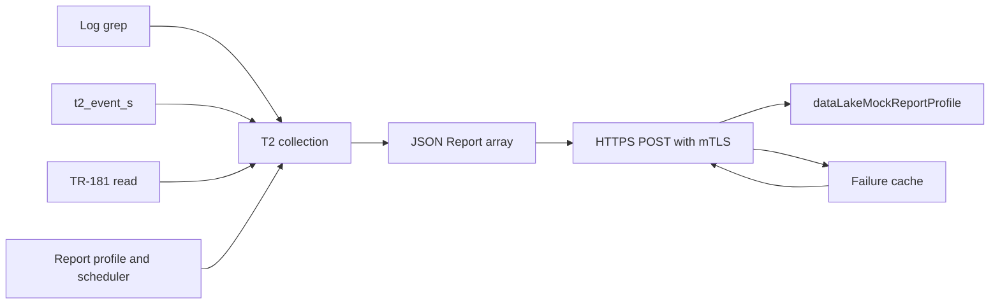

# RDK Telemetry 2.0 Docker setup spike

## Current invocation — stopped before setup

Request ID: `0e098663-0e4e-4832-8ae3-bf8bebe942ea`.

The authoritative user-instruction attachments could not be read at either supplied path. Setup and initial T2 inspection were not started. The historical results below are preserved, but were not reverified in this invocation and do not establish current host or container health.

### First failure: instruction attachment reads

Operation: `ContainerFileTools_read_files`, with both attachment paths supplied together. Raw result entries for the attachments:

```json
{"status": "ERROR", "message": "File not found: /Users/prajyusha/Desktop/docker-setup/temp-attachments/orchestrator_user_input_20260929_114315_155354.txt"}
{"status": "ERROR", "message": "File not found: /Users/prajyusha/Desktop/docker-setup/temp-attachments/orchestrator_user_input_20261015_091435_064665.txt"}
```

These are tool errors, not shell-command exit codes. The same read operation successfully loaded applicable skill instructions.

### Bounded attachment-location check

Only a read-only search was performed after the attachment failure, to check for relocated copies and preserve any existing setup log. No host setup checks, Docker commands, builds, installations, clones, or container inspection were performed.

Working directory: `/Users/prajyusha/Desktop/docker-setup`.

Exact shell command:

```sh
pwd; find . -type f \( -name 'orchestrator_user_input_20260929_114315_155354.txt' -o -name 'orchestrator_user_input_20261015_091435_064665.txt' -o -name 't2-spike-setup.md' \) -print
```

Exit code: `0`. Raw output:

```text
/Users/prajyusha/Desktop/docker-setup
./t2-spike-setup.md
```

Neither attachment was found by that workspace search. The existing setup log was then read to preserve its contents before adding this record.

### Blocker and resumption

The environment owner or requester must restore both authoritative attachments at the supplied paths, or provide accessible replacement attachment paths. Once available, read both attachments and execute their prescribed checks in order, stopping at the first failure and recording exact commands and raw outputs. Do not infer the approved sequence from the historical transcript. Only this Markdown log was edited; repository code was not modified.

## October 15 investigation — results and recommendations

**Outcome: partial acceptance, with real collector delivery.** Both images built and ran on macOS arm64/Docker Desktop 28.3.0. All three markers generated data, and collector logs prove receipt of grep, event, and data-model values. JSON and MsgPack loading worked. XConf loading remains blocked by missing RBUS providers. A second outage demonstrated caching but its post-restart replay remains unverified because Docker checks stopped returning. The earlier attachment was unavailable; the September transcript below supplied prior context.

### Setup and reproduction

Container repository revision: `696efa846cf56a558486894487be808ec69d7433`; separately cloned telemetry source: `a2f2a545e4bd6170eac96f7c0c46fbd4df6f1654`. The source checkout is not proven identical to every dependency fetched during image construction. Fresh native image: `sha256:87ff28ada7cd788f8280834194c2dfd4ad119d2b0b52acc4bd44e5672042352f`; mock image: `sha256:fc1be917169b36cc6bf88150c8082c9a70136adf89d45dcd3c4e395e09378816`.

Executed from the container repository:

```sh
GIT_TERMINAL_PROMPT=0 ./build.sh
docker compose up -d --force-recreate mock-xconf l2-container
```

Docker Desktop initially needed `open -a Docker`. This checkout has three Compose services; only the two requested services were started. Its `../` bind mount exposes this project base as `/mnt/L2_CONTAINER_SHARED_VOLUME`, not the README's home-directory volume. No unused home directory was created. Build export completed for both images; both containers were observed running. Startup still reported missing `/usr/local/bin/tr69hostif` and did not launch T2 automatically.

Executed manually:

```sh
docker exec native-platform /usr/local/bin/telemetry2_0
docker exec native-platform sh -c 'rbuscli setvalues Device.X_RDKCENTRAL-COM_T2.ReportProfiles string "$(cat /mnt/L2_CONTAINER_SHARED_VOLUME/utils/t2-spike-profile.json)"'
docker exec native-platform gcc -Wall -Wextra -Werror -I/usr/local/include /mnt/L2_CONTAINER_SHARED_VOLUME/utils/t2-spike-event.c -L/usr/local/lib -Wl,-rpath,/usr/local/lib -ltelemetry_msgsender -o /tmp/t2-spike-event
docker exec native-platform /tmp/t2-spike-event
docker exec native-platform rbuscli setvalues Device.X_RDK_WebConfig.webcfgSubdocForceReset string true
```

Allow asynchronous profile activation before sending events. Sender success alone is insufficient: early calls returned zero while caching events or racing profile reload. The compiled minimum is `#include <telemetry_busmessage_sender.h>`, `t2_init("t2_spike")`, `t2_event_s("SPIKE_EVENT","spike-event-ok")`, `t2_uninit()`, linked with `-ltelemetry_msgsender`; see [tested source](utils/t2-spike-event.c).

### Configuration, marker selection, and loading

The [profile fixture](utils/t2-spike-profile.json) contains a `profiles` envelope with `name`, `hash`, and `value`; the value declares HTTP/JSON, a 30-second reporting interval, parameters, and HTTP destination. It uses `RootName: Report`, `NameValuePair`, and `ReportTimestamp: None`. The final variation explicitly supplies an empty `RequestURIParameter` list; this is not a proven crash fix.

| Marker | Use and tested input |
|---|---|
| Grep | Count existing component log text; `SPIKE_MATCH` in the shared `utils/t2-spike.log`, emitted as `SPIKE_GREP`. Incremental seek positions mean later reports can omit an unchanged log. |
| Event | Prefer for custom component state transitions/errors; component `t2_spike` emits `SPIKE_EVENT` through the compiled API sender. |
| Data model | Read current TR-181 state; `SPIKE_DM` reads the mock's writable WebConfig reset field. Values were actually changed, not merely configured. |

JSON setter returned `setvalues succeeded..`; fresh T2 generated all three fields at `09:36:18.896`. MsgPack was separately tested on the cached-image phase: Python's preinstalled `msgpack 1.2.2` packed the same envelope, base64 encoded it, and supplied an RBUS **string** to `Device.X_RDKCENTRAL-COM_T2.ReportProfilesMsgPack`. T2 logged parsing, profile enablement, and `profiles.msgpack` persistence. This agrees with `source/ccspinterface/rbusInterface.c` and `test/functional-tests/tests/test_multiprofile_msgpacket.py`, not the telemetry README's bytes example. No host package installation was needed.

Authenticated GET of `https://mockxconf:50050/loguploader/getT2DCMSettings` returned HTTP 200. `mock-xconf/getT2DCMSettings.js` reads `/etc/xconf/xconf-dcm-response.json`, whose profile is the legacy `urn:settings:TelemetryProfile` representation, not the JSON multiprofile envelope. On both images, setting `Device.DeviceInfo.X_RDKCENTRAL-COM_RFC.Feature.Telemetry.ConfigURL` failed with RBUS error 5; `ModelName` is also absent. The supplied mock provider registers only the reset field. **The DCM response was not edited and a T2 XConf profile load was not completed.** Demo recommendation: use the proven JSON path; supplying the missing ConfigURL/device-identity providers is prerequisite follow-up work.

### Flow, runtime locations, and report contract



The requested bare `/dataLakeMock` returned 404. The implemented collector routes are `/dataLakeMockReportProfile` and `/dataLakeMockXconf`; the fixture uses the former at port 50051. Runtime paths observed or defined in `source/utils/persistence.h`: `/opt/logs/telemetry2_0.txt.0` plus rotated segments, `/opt/.t2reportprofiles/`, `/opt/.t2cachedmessages/`, `/opt/.t2persistentfolder/`, `/opt/.t2seekmap/`, and temporary `/tmp/t2reportprofiles/`. Profiles persisted as `T2Spike` or `profiles.msgpack`. Missing `/etc/debug.ini` produced a warning, not an immediate startup failure.

| Saved sample | Provenance and field-by-field interpretation |
|---|---|
| [Received grep/data-model](utils/t2-received-grep-dm.json) | Collector body: `Report` is an array of single-key objects; `SPIKE_DM: "false"` is the current mock string; `SPIKE_GREP: "1"` is the matching-line count encoded as a string. |
| [Received event/data-model](utils/t2-received-event-dm.json) | Collector body: `SPIKE_EVENT: "spike-event-ok"` is the API payload; `SPIKE_DM: "true"` reflects the changed field. |
| [Received cached report](utils/t2-received-cached-dm.json) | `REPORT_TYPE: "CACHED"` marks replay; `SPIKE_DM` is the value retained in that older report, not necessarily current state. |
| [Generated three-marker sample](utils/t2-generated-all-markers.json) | Exact logged body at `09:33:11.890`, also generated on the fresh image; **not itself a demonstrated collector receipt**. |

There is no timestamp or device identifier in these report bodies because this profile requests none. Log timestamps are not payload fields. A dashboard should parse the `Report` array, tolerate missing markers and string-encoded values, and distinguish cached records; add explicit identity/time parameters before multi-device use.

### Upload, failure tests, and recommendations

Source evidence: `source/t2parser/t2parser.c::processConfiguration` validates profile fields; `scheduler/scheduler.c::TimeoutThread` uses monotonic timed waits and notification callbacks; `bulkdata/profile.c::CollectAndReport` builds/sends reports. `protocol/http/multicurlinterface.c::http_pool_post` uses POST, `Accept: application/json`, `Content-type: application/json`, 30-second total/10-second connect timeouts, peer verification, and success on HTTP 200. These header/timeout details are source findings, not packet-capture measurements. Its certificate-selector retry is not evidence of exponential backoff. XConf fetch retry intervals must not be confused with upload scheduling.

The cached image had a GDB-confirmed SIGSEGV in `prepareHttpUrl`; one initial fresh-image run also exited, without a captured cause. A later fresh-image run under GDB remained alive and completed delivery. Thus unattended startup stability is **not proven fixed**.

The fresh pair initially used stale imported CAs: installed/shared public certificate hashes differed and curl returned error 60. An explicit shared-root probe succeeded without `-k`. This executed repair refreshed only server trust, preserving client credentials:

```sh
docker exec -e ENABLE_MTLS=false -e ENABLE_CRL_L3=false native-platform /usr/local/bin/certs.sh
```

Those flags applied only to that setup subprocess; T2 continued using mTLS. At `09:39:22.967`, T2 logged HTTP 200 and replayed four TLS-failure cached reports; collector logs confirm their bodies and the cache directory became empty.

A subsequent `docker stop --timeout 5 mockxconf` outage kept T2 PID 2817 alive. At `09:40:23.038`, curl error 6 (DNS unavailable) produced a persistent cached report; further 30-second cycles accumulated three reports. `docker start mockxconf` returned, but the immediate recovery window still showed caching. Follow-up Docker readiness checks timed out after 300 seconds, then 180 seconds; **replay after this second outage and final service health remain unverified**. Source defines `MAX_CACHED_REPORTS=5` and replay after a successful current report, but cache-limit behavior was not exercised.

Keep the mock for the initial JSON demo and use direct events for the custom component; reserve grep for existing logs and TR-181 for queryable state. For a durable dashboard, prefer a custom collector with persistence and explicit identity/time metadata. The existing mock logs requests; its optional capture handler references undefined `body` in `JSON.parse(body)` (source finding, not reproduced), so do not treat it as durable storage.

Evidence: [cached phase](utils/t2-cached-image-evidence.txt), [fresh phase](utils/t2-fresh-image-evidence.txt). All known long-running command sessions were terminated successfully; this does not establish final container health. Final debugger output also showed repeated curl error 7 after restart, without replay evidence. Remaining work belongs to the environment owner: restore Docker responsiveness, verify service readiness/replay, restore the mock reset value (last verified `true`), and provide XConf URL/device-identity RBUS providers before testing an edited DCM profile. No production source files were changed.

## Historical September 29 attempt

The following transcript describes only the earlier invocation. At that time the first clone did not complete and was terminated after it remained running without further output. No later setup or container commands were attempted in that invocation.

## 1. Host and Docker checks

### `uname -a`

Exit code: 0

```text
Darwin Unknown_c6:eb:ac:3f:c3:66 25.6.0 Darwin Kernel Version 25.6.0: Fri Jul 31 19:11:03 PDT 2026; root:xnu-12377.161.14~5/RELEASE_ARM64_T8132 arm64
```

### `uname -m`

Exit code: 0

```text
arm64
```

### `docker version`

Exit code: 0

```text
Client:
 Version:           28.3.0
 API version:       1.51
 Go version:        go1.24.4
 Git commit:        38b7060
 Built:             Tue Jun 24 15:41:51 2025
 OS/Arch:           darwin/arm64
 Context:           desktop-linux

Server: Docker Desktop 4.43.1 (198352)
 Engine:
  Version:          28.3.0
  API version:      1.51 (minimum version 1.24)
  Go version:       go1.24.4
  Git commit:       265f709
  Built:            Tue Jun 24 15:44:06 2025
  OS/Arch:          linux/arm64
  Experimental:     false
 containerd:
  Version:          1.7.27
  GitCommit:        05044ec0a9a75232cad458027ca83437aae3f4da
 runc:
  Version:          1.2.5
  GitCommit:        v1.2.5-0-g59923ef
 docker-init:
  Version:          0.19.0
  GitCommit:        de40ad0
```

### `docker compose version`

Exit code: 0

```text
Docker Compose version v2.38.1-desktop.1
```

## 2. Repository clones

### `git clone https://github.com/rdkcentral/docker-device-mgt-service-test`

Working directory: `/Users/prajyusha/Desktop/docker-setup`

Initial status: RUNNING; no exit code returned.

```text
Cloning into 'docker-device-mgt-service-test'...
```

Subsequent output captures returned no additional output and continued to report RUNNING. The process was then terminated; the termination returned no output. Clone completion was not confirmed, and no successful exit code was returned.

## Stopping point

Stopped during the first clone. The `telemetry` clone and all subsequent commands were not attempted. No repository code was modified.

## Summary

| Topic | Summary |
|---|---|
| Current invocation | Stopped before setup: both authoritative attachments were missing, and a bounded workspace search found neither file. Restore accessible attachments before resuming. |
| Historical evidence | The following rows summarize earlier recorded results only; no current host or container health was verified in this invocation. |
| Environment | Both fresh images built and ran; T2 was launched manually. |
| PoC | Three marker types generated; collector receipt proved for each type across saved samples. |
| Loading | JSON and MsgPack tested successfully; XConf loading blocked by absent providers. |
| Failure handling | TLS-failure cache/replay proved; outage caching proved, later outage recovery unverified. |
| Remaining blockers | Docker/tool responsiveness, unattended daemon stability, and XConf provider coverage. |
